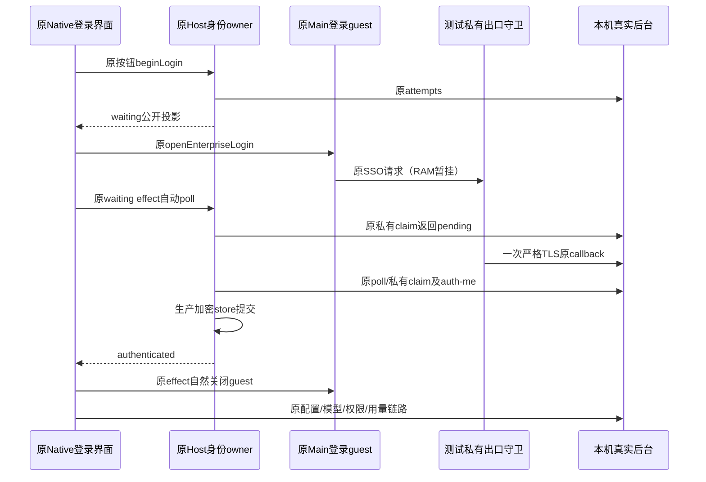
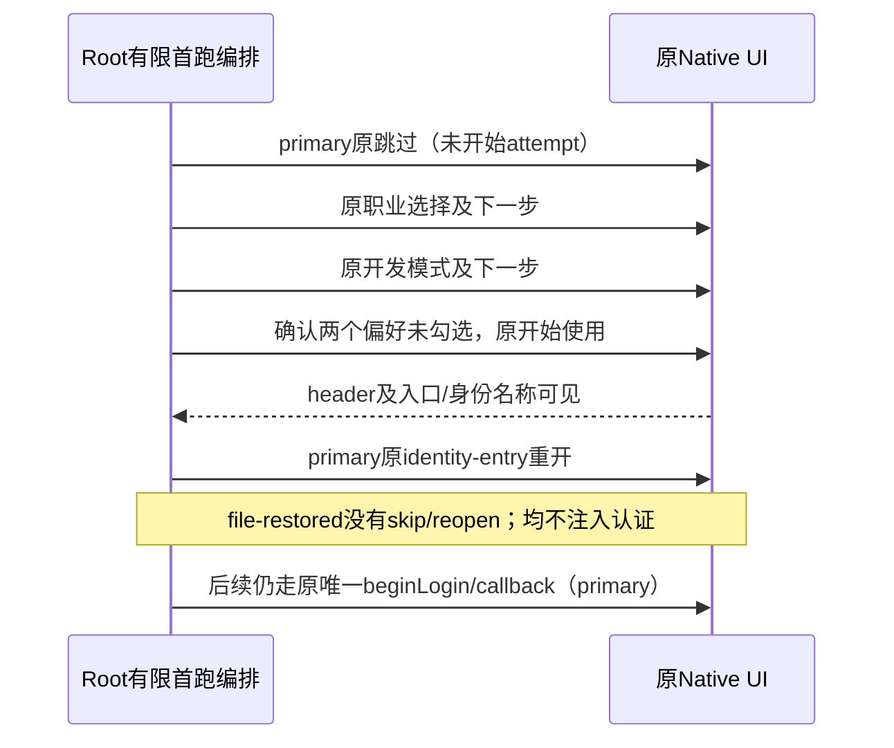

# 客户端空身份原生登录联测合同

本合同验证既有生产登录链路；仅测试夹具替换外部身份兑换和网络出口，不新增产品身份 owner、认证 API 或会话写入路径。真实企微页面、二维码、扫码、外部 MCP 和网盘继续排除。

## 起点与所有者

- 每次运行认领全新独占根、HOME、profile 和浏览器控制目录。Native 起点只写公开 backend/tenant/Corp/agent/callback 和本次 CA；不预种成员 email 会话、共享 Token、Provider 或有效 Gateway 状态，不做模型预热。
- 管理者仅用正常后台 API 建立受控模型、普通 member、部门、席位、身份映射和额度；成员限额必须写给实际待登录成员并 GET 回读。
- 原 Host 继续持有 attempt proof、会话、issuer、加密存储及当前用户事实。Renderer 只使用原公开投影；模型供应商 Key 由后台 Vault 持有和派发。
- 原 201 attempts、claim、callback 和生产加密提交保持原逻辑，测试观察器不主动 claim、签发会话或修改响应。
- 私有控制器的 ready 早于生产 Main 导入完成，不能作为单实例锁或界面就绪证明。原 launch 后先记录实际 Main 的 PID/PPID/birth、per-PID 入口、cwd 与 CDP 归属；在该独占端点的唯一受信任 renderer 中用固定公开布尔确认登录页就绪，才允许一次原 openWorkspace。命令收集器先持久保存原始安全进程事件，再处理命令失败。

## 接线和取证

### 原 UI 首跑前置

空身份首跑可以在首次 beginLogin 之前，经原 `enterprise-login-skip` 关闭登录 Dialog，再正常完成职业引导，最后由原 `enterprise-identity-entry` 重开登录。跳过前必须未 auth-start、无 waiting/已开始 attempt；跳过不是取消后重试，不能增加 attempt/callback。引导保存经过原 UI 的设置与本地引导记录写入，属于产品动作结果，不允许夹具预种偏好、直接调用 setting/React/store 或伪造身份。

测试薄入口为 `scripts/fixtures/native-first-run-ui.py`。`primary-prelogin` 模式仅允许固定 skip → 软件开发/数据/AI → 职业页下一步 → 开发 → 模式页下一步 → 偏好页开始使用 → identity-entry reopen；实际唯一企业登录仍由原 primary actor 执行。`file-restored` 模式只允许上述职业/模式/偏好步骤，禁止 skip/reopen/logout 或身份修改。Root 的原 owned guard、预算和 wx 一次性 claim 继续是编排所有者，本入口不创建 runner、R、RPC 或允许缓存。原 primary-ui.py、Main 认证三布尔和3000ms/25轮守卫保持原字节与语义。

DOM 只使用固定可见布尔、选择匹配与数字几何：root-startup-loading、onboarding-page、workspace-mode-header、原登录页/身份入口；职业与模式控件限定在该引导页的原 role=group，三个前进控件限定在实际 aria-current step 的 footer/button，中文标题/标签精确匹配。选择“开发”后，偏好页必须恰有工作记忆与迁移两个未勾选控件；测试不点击或改写偏好。默认不是 false、步骤异常、重复动作、等待/认证前置不符或命中几何不确定即停止。所有实际操作只有真实 Input.dispatchMouseEvent，不使用任意 JS/Input、DOM.click、AX/截图、Storage、Token 或网络正文。

每动作都先执行 guard/budget，再持久 claim `first_run_<step>`，Root 换代或重复 claim 不得再输入。完成就绪必须启动壳和引导均消失且 workspace-mode-header 可见；primary 还必须 identity-entry 可见、identity-name 不可见，file 则要求 identity-name 可见。composer 不存在不能被解释为空白就绪。原事实生产器另行证明模型/账本零增量；引导可见、完成或一次内存 draft 预热都不是认证或模型验收。

原 Main 导入前安装唯一 Session 请求守卫。只允许已绑定的原窗口/guest/Session/main-frame GET；父夹具在 RAM 对齐原 attempt、nonce、六项 SSO 参数、回调、TTL 和请求标识。官方 SSO 一直暂挂，确认 held 后确有原 pending claim 才允许一次无参受控 callback；原 Hook 成功后自然关闭 guest，守卫不抢先取消成功路径。

nonce/state/URL 只过匿名 IPC RAM。原 Main 导入前清除私有 channel bootstrap 环境与测试 flag，Host/CLI 不继承控制 fd。消息、输出、初始化、授权见证和 callback 均有数量/字节/绝对截止；primary 原始 Electron stdout/stderr 只计数，不解码落盘。默认夹具分支保持原行为。

primary 启动器使用真正的 entry.mjs，先执行环境守卫，再以顶层 await 等待适配器和原 Main 导入；关键初始化链不能裸用 import().then，也不能等待 app.whenReady 后再导入。此时序遵循 [Electron ESM 说明](https://www.electronjs.org/docs/latest/tutorial/esm)。启动器自己用 wx0600 写 pid/ppid/isPackaged/appPath 四字段记录；后续准备只核对生成器的精确入口字节，不再前插 CJS 代码。默认模式仍使用原 entry.cjs。

测试入口诊断仅允许 secondary_argv_shape、owned_workspace、session_guard、main_import、private_channel 五种固定拒绝码，以及已拥有进程的实际退出 code/signal。拒绝收据用 wx0600 保留第一次结果，不记录原异常、cause、argv、URL 或请求详情。这些测试收据不能作为产品认证或用户权限的来源。

仅 session_guard 可附 diagnostic，精确四字段为 reason、lastProjection、completedReads、inFlight。reason 仅接受 auth_deadline、auth_exhausted、auth_read_rejected、auth_projection_invalid、request_denied、external_open_denied、channel_send_failed、private_control_rejected；lastProjection 仅为 null 或原固定表达式的 authenticated/signedOut/loginVisible 三个布尔，completedReads 是已结算读取次数（整数 0–25），inFlight 是当前读取是否仍在等待的布尔。未知、额外字段、非法枚举或不合法的布尔/次数不得落盘；入口独立验证后只复制这些固定字段，非法 diagnostic 丢弃而保留原固定 code。其它四种 code 的收据仍只有 pid/code。原 3000ms 绝对截止、25 轮、网络和 OS 外跳拒绝、SSO 暂挂和认证放行条件保持不变；诊断不扩大观察范围，也不将 callback、claim 或 guest 关闭当作认证成功。

登录输入前锁定敏感观察；随后只允许固定公开布尔、文本和原控件几何及 Browser Harness 物理输入。禁止读取或输出原始 AX/截图/DOM、链接、网络明文、Cookie、Storage、proof、Token 和 OAuth 参数。冷启动的新 Root 必须重新核对实际 PID/PPID/birth/appPath/CDP 与受信任 renderer，不沿用旧 attachment。

只读 `observe`、`first_run_observe`、`preworkspace` 的收据使用同一独占编号分配器，每个相位/epoch最多128份，不能再写固定同名文件或依靠 glob 数量推算。分配器以目录 fd 限定已拥有的0700目录，拒绝目录/文件符号链接与不符权限；每份新收据 O_EXCL、0600。业务动作收据仍固定 wx 一次，原输入前 journal 保持。完整 dispatcher 在运行前封存精确字节，真实临时文件合同须覆盖重复观察、多相位、并发与业务重复拒绝，运行时不临场重写。

原生产快照、stopNative 和 owned openWorkspace 仍使用原有限接口；不提供通用 RPC。primary supplier 只接受精确 models/chat 路径和本次正常 API 创建的后台 Key；拒绝未知路径、query 变体或错误凭据，Trace 与默认模式保持原行为。公开证据只输出匹配计数、角色/额度及本人账本归属布尔。

冷启后，原身份菜单打开时精确核对公司；原网关设置页打开后核对姓名、部门、角色、额度与用量。页面所属字段不可见时记为不适用，不能当成功或故障。设置页覆盖期间，原 workspace 保留布局但不可交互；返回任务必须先执行独立的 `back_to_workspace`，点击原 `TID_SETTINGS_BACK_BUTTON`，只读等待覆盖退去且原任务行可点，再执行既有 `return_conversation` 选择已固定的原 task。两个原动作各有输入前的独占 journal 与一次结果收据，失败不能重放。不得点击遮挡中的任务行、直接改 tab store、注入状态或以新任务代替原任务。该补充来自 v7 的真实 `CONTROL_NOT_READY` 边界，仅修正测试导航，不改变产品行为。

## 接受边界

1. 全新 Native 原按钮完成一次登录，真实 attempts/pending/callback/claim/auth-me 与原 guest 自然关闭均有证据。
2. 原公开配置、可选模型、普通成员权限、有效额度及本人用量吻合实际后台；原一次对话经后台到受控 supplier，Key 匹配且账本归当前成员。
3. 同 profile 冷启后不增加 SSO attempt 自动恢复；原退出后配置/用量投影退休、新发送拒绝且无 supplier/账本增量；再次冷启保持退出。
4. 每业务动作一次、无业务重试，780 秒业务/900 秒总预算，witness soft96/hard128。首次失败停止业务并先清理；未知写者或清理不确定时保留私有根，不查询/操作外部持有者。

接线代码的独审通过后，Root 可以显式将测试 review 锁设为 true，并复验完整有限合同；这只允许进入后续受控 Native 测试。组件 25/25、Node IPC 微探针、有限合同以及 review 锁解除都不代表本合同已验收，完成仍需上述实际 Native 证据。
