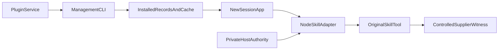

# Owned plugin installation to Skill consumption bridge

This bounded local slice complements G04f's completed Native installation lifecycle. It uses the existing production Host `createZCodeAgentService`, `createPluginManagementService`, normal packaged CLI, real loopback HTTP and real owned files. It does not repeat Native UI installation or claim official-marketplace, WeCom, external MCP, drive or cross-platform acceptance. No runtime starts until Root separately approves frozen definitions and current normal artifacts.

The original member API creates one ordinary member in the isolated tenant. Real email login and `/api/auth/me` verify role=member, the exact tenant/user IDs, seat and a user distinct from the admin before the original restore/store/private backendSession is built from that member token. The isolated admin is used only for setup and configuration publication; model accounting belongs to the actual member.

## Existing owners and permission contract

The original marketplace installer alone writes installed records and versioned cache. The original plugin loader reads those records, manifest roots and enabled configuration; bootstrap supplies its result to the existing NodeSkillAdapter. The runner must not write installed records, inject plugin roots, replace PluginService/SkillPort, or call loadSkill directly as a substitute for the original Skill tool.

Plugin enable changes are configuration changes. App creation/cold restoration resolves the plugin roots and freezes the session catalog. Existing sessions do not hot-load a new plugin. Test disabled/enabled visibility using separately created sessions; do not require an existing session to lose its snapshot immediately after disable.

The actual Host createSession forwards session/create. server-operations creates a new session ID and materializes a new record; materialization calls createWorkspaceZCodeApp, which directly calls deps.createZCodeApp. create-app then resolves startup plugins from its configuration again. D and S therefore have different Apps even when ProcessManager reuses one workspace CLI. A new name attached to an existing App would not satisfy this test.

The Host startup readiness source is the same owned, real `ProviderRuntime.modelSelection` facade that reads the private registry after the original Gateway provisioning. Pass this facade unchanged as `modelSelectionReadinessSource`; do not manufacture a ready result or bypass the production provider/model gate. The normal CLI reads the same private personal-provider file through its original environment and registry initialization. This UCAS file-backed slice does not use account providers: the optional `accountProviderConfigSource` remains absent under its original no-op sync contract, rather than supplying a fabricated account snapshot.

The fixture's explicit model selection must be complete. Read the original model-selection view, find the exact published provider/model, and require its original `preferredSelection` to match both IDs before taking that selection's declared reasoning level. The same real `ProviderRuntime.registryService.validateSelection` must accept the complete result before the Host is created. A missing or different-model preference stops preparation; do not hardcode a level, borrow another model's preference, omit the requested model or change the legacy entry to conceal an invalid selection. The model view exposes allowed option values rather than a default property, and passing a selection without options to `getView` only reports its selection issue; it does not supply the missing level.

Managed personal/plugin Skill operations require current filesystem, personal.skills and dangerousSkills allowances. Every discover/load re-reads the original Host catalog and authorizes before/after adapter I/O using the same private owner. With personal.skills=false, personal entries are omitted; an old explicit name reaches the original enterprise_skill_not_found path. A previously delivered body need not disappear from context. Use a second Skill B that has never been loaded to test denial without making an impossible retroactive-erasure claim.

## Finite execution

1. Create a fresh isolated test home/storage/workspace and the existing real email/store authority, backend and Host model relay. A self-owned HTTP server serves one checksummed static plugin zip containing only a manifest and Skill A/B. Original add-marketplace/install APIs must create the actual record and cache. Verify the owned cached manifest and both exact SKILL.md bytes. No hooks, commands, MCP, scripts or executable files exist in the package.
   The manifest declares only `skills:["./bridge-skill-bundles"]`; A/B live below this non-default directory and no default `skills/` exists. Actual catalog paths and the consumed base directory must prove this manifest root was used.
2. Original set-enabled false followed by new session D must omit this plugin; original set-enabled true followed by new session S must discover both qualified names and the correct plugin identity. Installation and catalogs cause zero supplier/model/ledger increments. Preserve D's original snapshot rather than requiring a hot update.
3. S sends one fixed A prompt. The controlled supplier emits one original Skill call by qualified name. Match its actual tool_call_id and require the exact A body marker and installed cache base directory in the returned tool content and subsequent model request. Other tools and unexpected requests fail closed.
4. Publish personal.skills=false through the original backend API and GET the published value. Keep filesystem/dangerousSkills true to isolate this policy. S sends one fixed B prompt; require the original failure, no B body in tool output or any following model request, and current draft discovery without the plugin skill. Restore true only for one current catalog observation, not another model send.
5. Supplier requests are exactly two A-main, two B-main and one original title request. The reused controlled supplier reports 5 input/2 output tokens, while its model rates are 1000/2000: exactly 25 input/10 output/45 Credit for these five calls. Any initialization is recorded as a separate baseline. This supersedes the planning page's provisional 110 Credit; do not alter production metering or accept flexible totals to match it.

## Evidence identity

`gateway_calls` and `ledger` share the actual `(tenant_id, request_key)` produced by the backend. Compare exact full key sets and record the ledger IDs. Current `traces` has independent IDs and no request-key foreign key: preserve its full ID set and measured fields without assigning traces to requests by time, tokens or sequence. Supplier receipt IDs and tool_call_ids are another independent complete set. No response ID, Fastify request ID, trace ID or supplier ID is relabelled as a backend request key.

Public evidence is a fixed projection: source/artifact hashes, safe lifecycle receipts, exact ID/key sets, tool-marker/path booleans, configuration booleans and usage. Tokens, credentials, full model messages, reverse frames, stderr and original error causes stay out of public evidence. Malformed or additional projection fields fail closed. Failure output is a fixed stage/code; do not print a raw assertion payload or backend response.

## Limits and cleanup

There are two business sends, one install, bounded catalog observations and zero business retries. The business deadline is 240 seconds, total deadline 360 seconds. Original Skill 30-second and private authorization deadlines remain. Source, CLI and stage hashes are checked before a later explicit Go; no rebuild or Desktop/Common/BH/browser is required.

The original Skill declares no interactive approval. This test does not add an allow responder: unexpected pending permission or provider retry is a first failure. `readSession` uses `runtimePolicy:existing-only`; send ACK alone is insufficient. Completion requires the normal idle/completed state, no active turn/pending request, the fixed completed reply and settled accounting.

Dispose the original Host/CLI services and owned HTTP listeners with bounded waits. Preserve the owned private directory even on success; it must never be recursively removed by the reused fixture's default cleanup. Original helper handles and source-owned PID/PPID/birth records are retained. Only complete stderr-free scoped process/FD queries can prove closure; uncertainty or unknown writers preserves 0700 and hands off exact known handles. Never discover or signal an unknown FD holder, read any older retained root, or touch the user's main backend.

## Preparation verification

Use finite pure contracts for exact ID-key relationships with independent/same-token trace and supplier IDs, marker/tool_call_id matching, once-only sequence, denied B non-leak, malformed input rejection and cleanup preservation. These contracts start no Host/CLI/backend or browser. They are preparation evidence, not bridge acceptance. The later real run owns the Host/normal-CLI/HTTP/FS proof and any observed defect must retain RED before a scoped fix and rerun.
