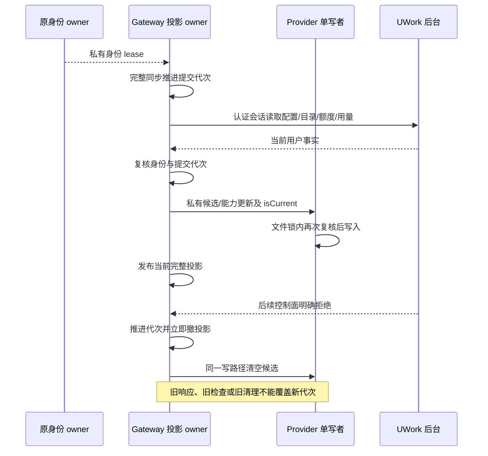

# 企业用户配置、权限与用量链路验收

2026-10-17，Asia/Shanghai。本轮在当前仓库的 `clients/uwork/` 开发并构建，未修改原客户端仓库或用户安装的 UWork。真实企微、外部 MCP、网盘按约定不测。

## 结论与验收边界

合成企业用户通过实际 email HTTP 登录取得会话，再经生产加密会话存储和既有身份 owner 恢复；后续配置、权限、模型调用和用量均经过实际后台。真实企微扫码尚未验收，合成身份不能替代企微生产接入。

实际 macOS Electron/Main/Host/打包 CLI 已验证：首次自动选择当前授权模型并完成对话；部门、角色、企微映射 ID 正确显示；额度不足时后台拒绝派发；额度恢复后仅点击用量“刷新”即可更新有效余额；撤销席位或服务端注销后清除过期配置和模型候选，恢复席位后完整同步可恢复。

供应商生成使用本机受控服务，不产生真实供应商调用或费用。主实例只做认证读取与已保存供应商目录探测，未执行付费生成；原业务配置和账本哈希保持一致。

## 修复与复测

| 实际发现                                              | 最终行为                                                                                    |
| ----------------------------------------------------- | ------------------------------------------------------------------------------------------- |
| 账户丢失部门、企微映射，操作员/审计员被显示为普通用户 | `/api/auth/me` 返回当前租户成员映射，客户端保留并本地化实际角色                             |
| 个人额度参考值被误当成最终可用额度                    | 同一个预算计算驱动预留准入和 `effectiveAllowance`；界面区分个人参考值与综合有效额度         |
| 后台恢复额度后，用量刷新仍显示旧余额                  | 同次刷新读取套餐、有效额度和本人用量，完整成功后发布                                        |
| 控制面 401/403/订阅失效后旧目录、用量仍存在           | 明确拒绝立即撤销授权投影及私有候选；401 与权限/席位/订阅错误分别提示                        |
| 撤权后迟到的成功响应、旧清理操作可覆盖新投影          | Gateway 内部提交代次叠加原身份 lease；异步检查后再次复核；Provider 文件锁内检查同一私有回调 |
| 首次默认模型仍落在旧 UCAS 种子，Native 请求返回 400   | 私有 writer 写非秘密候选快照，真实 Registry 只允许当前企业目录成为可执行/可选默认           |
| 模型声明不支持工具，CLI 仍自动发送工具列表            | 既有 `getTools(model)` 对明确不支持工具的模型返回空；工具历史与严格参数校验保留             |

模型 POST 的额度 402 不撤销有效目录；控制面订阅 402 则使授权投影失效。同身份暂时网络/503 错误可保留已完成快照，新身份不能继承旧候选。空目录是有效结果；缺失/null 企业候选默认不可执行。候选快照不授予权限，本地篡改后的模型请求仍被后台 403 拒绝，上游和账本不增加。

`blocked` 描述额度状态，不能被 UI 当作所有执行的绝对禁令：额度恰好为零时，零定价请求仍遵循后台原有准入规则。历史超额不因零定价绕过。有效额度对象不返回其他成员明细、共享使用汇总或限制主体 ID。

## 最终验证结果

| 层次                 | 通过结果                               | 证据内容                                                                                           |
| -------------------- | -------------------------------------- | -------------------------------------------------------------------------------------------------- |
| 后端全量             | 249/249                                | 真实 HTTP/TCP、权限、计量、重启、取消和原有合同                                                    |
| 企业用户后台链路     | 129 次 HTTP 检查、10 次受控上游        | 同用户双企业、设备/会话隔离、角色/席位/部门变更、祖先/个人/企业/应用限制、本人用量、重启与账务核对 |
| 新增 HTTPS/Host 链路 | 24/24，935 次 HTTP 响应、19 次受控上游 | 私有身份/目录/有效额度、401/403/402、空目录、503 恢复、迟到响应和清理竞态                          |
| 原有 HTTPS 回归      | 9/9                                    | 原能力描述、身份代次及私有 Host JSON/SSE 转发                                                      |
| 客户端服务           | 259/259                                | 包含独立安全 4 项、异步投影检查 unit；全部未跳过                                                   |
| Core 永久测试        | 15/15                                  | 模型候选 6 项、会话 relay 9 项                                                                     |
| 实际 SDK             | 3/3                                    | 5 次受控上游，5 条 settled                                                                         |
| 实际打包 CLI stdio   | 5/5                                    | 7 次受控上游；5 settled、2 uncertain，含无手选首次 SSE/标题 JSON、open/read 取消                   |
| 跨模块合同与打包资产 | 13/13                                  | 使用当前仓库构建的真实 CLI 资产                                                                    |
| UI 角色测试          | 1/1                                    | 8 个实际/兼容角色及未知输入                                                                        |

这些覆盖有重叠，不相加为总测试数。uncertain 是已派发调用的保守预留，不表示供应商未执行或费用退款。

Native 隔离夹具中，用户甲初次对话和自动标题结算 2 次/44 Credit，用户乙另有 2 次/44 Credit。部门额度设为 0 后新请求被拒绝，没有新增派发；恢复部门额度为 200,000 后只点刷新，实际显示 149,956。恢复后的新任务与标题又结算 2 次，用户甲面板最终为 4 次/88 Credit、有效额度 149,912；企业总账为 6 次，用户乙的 2 次未混入甲的用量。终端凭据数为 0。最后服务端注销返回 401，原生工具栏不再有可用企业模型，账户、套餐、额度和用量投影清除。

实际持久化 Provider 仅保留 `enterprise-session` 模式；不含 `apiKey` 或 Authorization 字段。服务端注销后 `enterpriseModelIds` 为空。登录 Token 在 Host 私有身份存储；供应商 Key 在后台 Vault；Renderer 和 CLI 不接收这两类凭据。HTTPS 通过产品 custom CA 注入独立测试证书，未关闭 TLS 校验。

## 状态所有者与提交顺序

该代次仅顺序化 Gateway 的派生投影，不建立第二份身份或 Token owner，不承诺回滚已经合法准入的文件事务。

## 构建、证据与运行

客户端使用 Node 24.14.0/pnpm 10.33.2；CLI 正式构建和 staged 文件 SHA256 均为 `f304dc951987a54c5dcd3e59c6601d5e8966a771afa847e756a41058cd046e95`，16,550,266 字节。原生 Electron 41.10.7（Node 24.18.0）运行最终仓库构建。后端类型、构建、全量测试通过；客户端全量类型、Lint、定向格式和架构检查通过，保留既有 114 条客户端/53 条 CLI 警告，0 错误。Vite 原有 chunk/插件耗时提示保留。

原始 RED 和 GREEN 保存在 ignored `evidence/`：

- `client-user-permission-journey-20261017/summary.json`：后台用户/额度链路与 249 项全量检查。
- `client-user-journey-20261017/summary-final-24.json`：24 HTTPS、259 服务、旧 9 项及门禁。
- `client-live-20261017-catalog/summary.json`：真实 Registry、SDK、打包 CLI、构建哈希。
- `client-catalog-security-20261017/review-summary.json`：4 项独立安全复核。
- `client-user-journey-20261017/native-*.txt/png`：原生初始失败、自动默认、额度拒绝与恢复、本人用量、席位和会话撤销。

测试夹具准备错误（缺 publicUrl、缺合成企微映射配置、AX 渲染/滚动等待、误用额度文案断言）与测试脚本类型错误单独保留并修正，不记作产品缺陷或已通过测试；未降低校验标准或删除断言。

主实例 `http://localhost:3000` 保持运行；已在线备份到 `data/backups/pre-user-journey-20261017.sqlite` 后正常释放租约更新。健康 200、当前成员映射与有效额度已生效；实际已配置供应商目录探测成功（341ms）。原业务资源/版本、配置/历史、策略、成员、Vault、订阅和账本哈希不变，原账本仍为 settled 23 条/8,474 Credit、released 1 条/0、uncertain 1 条/5,150。镜像 `uwork-backend:user-journey-20261017` 构建成功，未切换默认 Docker context。

本轮测试自有端口、Electron、浏览器控制 daemon、会话和临时数据库在验收后清理。主后端与项目专用 Colima 保持运行。真实企微扫码/生产 HTTPS、外部 MCP、网盘、Windows/Linux 安装和手机/远程工作区端到端仍未验收。
