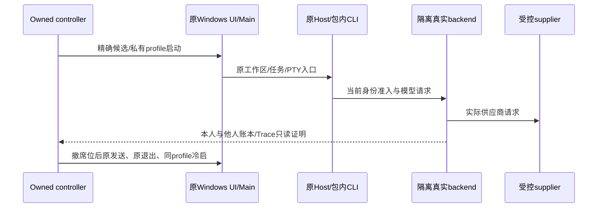

# Windows Native客户端与后端实际联测执行计划

当前仅完成可复核的源码准备，没有授权Windows入口，未连接Windows、跨产包、运行安装器或GUI。本机为Mac ARM64；既有Mac与Linux成功不计Windows通过。实际任务须由Root取得授权入口、冻结候选和新driver后另行单次Go，用户不需要手工测试。

[只读facts](../evidence/client-windows-native-linkage-execution-plan-20261021/readonly-facts.json)记录22个源码SHA及18个本地既有Windows原生文件/归档的静态信息。源码freshness检查exit0；无tracking branch/origin-main的两项距离检查按原工具跳过。PE头、归档存在和版本声明均不等于Windows ABI或运行验收。

## 实际入口与前置

必须先确认授权host、Windows build/CPU架构、实际进程架构、交互用户/SID/session及允许的执行/传输方式。没有入口或只有无交互的服务session时，不把GUI步骤写成通过；不猜测主机，不读取个人RDP密码，不启云、不安装OS或接受license。WSL/Linux、Wine或Mac交叉产包都不是Windows Native实测；Windows ARM上的x64兼容运行也须与原生x64/ARM64分别标明。

测试使用独立目录、数据/凭据根、工作区、端口和专有进程句柄。原app保持Main→window Host→包内CLI所有者链，受控supplier与真实隔离backend使用原HTTP/SDK、账本和Trace。优先在授权Windows上运行隔离backend与supplier并使用loopback；若只能复用Mac侧fixture，须另外审查有界隧道、CA/SAN和真实客户端可达URL，不能把Windows的127.0.0.1当成Mac监听。TLS校验保持开启，不能因缺openssl直接关闭验证。

只操作精确owned Electron target。原CDP file URL应来自该Windows包的`resources/app.asar`，验证Main PID、CreationDate、ExecutablePath和owned监听后，先等唯一原renderer再attach。browser-harness须有可核对的执行位置与私有控制根；现Mac bridge不能直接在Windows运行。可按实际入口另审本机BH到精确远端owned端口的转发，不接个人浏览器，不使用全局键鼠、clipboard或默认外链作为捷径。

## 原producer与制品合同

源码提供目标`win32-x64`、`win32-arm64`；原prepare使用`ZCODE_TARGET_OS`/`ZCODE_TARGET_ARCH`，Windows命令为`pnpm.cmd`，Agent由`prepare:agent-bundle`正常stage。实际目标必须与builder Windows context一致，不能仅改manifest标签。后续候选生产顺序仍是原`prepare:runtime-assets`→`build:no-runtime-assets`→原builder Windows目标/`--publish never`，使用独立输出、正常Preview身份及当前冻结Agent，先审查再执行；本轮没有运行这些命令或写shared out/assets。

原Windows正式target为NSIS，`oneClick:false`、允许选择安装目录，并有`.zcode-install-manifest`及原安装/更新清理逻辑。先核实际已有候选来源；若需新正常包，核app.asar、包内CLI、provider配置、PE架构、node-pty JS/native及全部目标运行资源的字节SHA，记录实际Authenticode状态。不能把Mac codesign检查搬到Windows，也不能把未签名候选称为签名发行。dir候选运行、NSIS安装、覆盖更新、卸载是不同边界；只跑dir不能关闭安装验收。安装器UAC/许可/默认关联变化须在实际授权范围内，不自动接受未知提示。

Desktop声明Electron41.10.7、node-pty1.1.0；本地存在两种Windows架构的prebuild和Windows搜索归档，但仍需实际候选验证。原node-pty postinstall优先已有Windows prebuild，缺失才electron-rebuild；Linux专项restore不会为Windows注入beta或伪造兼容。完整target目录须unpack，不能只核`pty.node`而遗漏conpty/native DLL/辅助exe。原native-search Windows目标是ugrep/ripgrep，不要求不存在的bfs。

Windows browser-import helper默认关闭，只有原显式开关才prepare；x64依赖可信csc，ARM64还要求明确的ARM64-capable compiler。它不是核心模型/PTY链路的必需前置，不为本轮额外安装编译器。Mac Swift window-bounds helper不属于Windows资源。任何CUA/导入等可选能力按真实制品分别记available/unavailable，不能用省略可选项宣称全Windows功能通过。

## Mac驱动必须拆开的入口差异

| 现有代码/假设                                                                         | Windows计划与验收边界                                                                                                                                                             |
| ------------------------------------------------------------------------------------- | --------------------------------------------------------------------------------------------------------------------------------------------------------------------------------- |
| Mac strict loader固定Library/Caches、`.app/Contents`、Mach-O、PlistBuddy、codesign    | 新独立Windows严格loader仅绑定实际候选、PE架构、资源SHA及签名事实；旧loader保持冻结。                                                                                              |
| `Fixture`写死Node24 `/Users/...`、PATH冒号、`HOME/TMPDIR`，Common中有openssl与symlink | Windows新私有输入核实际可用Node与命令；PATH用平台delimiter、大小写保留Path，TEMP/TMP/APPDATA/LOCALAPPDATA与产品data-root分别核。junction/symlink权限不可假设；不能借失败改生产。  |
| `OsGuard`为Mac Swift guard，使用LaunchServices/原protocol恢复                         | Windows原启动可能注册zcode scheme/Explorer关联；独立记录当前SID的相关归属和恢复能力。HOME隔离不等于HKCU隔离；优先专用测试用户，未能安全恢复时保留明确未验或失败，不覆盖他人关联。 |
| `.app` PID/CWD映射靠ps/pgrep/lsof、`/dev/ttys`                                        | Windows用CIM/Process StartTime/ExecutablePath及精确进程树，检查PID复用；不能用process title或一次taskkill结果当已关闭。                                                           |
| Common `detached:true`配`process.kill(-pid,SIGTERM/SIGKILL)`                          | POSIX负PGID停止不能照搬。新独立controller须有可review的owned进程句柄/身份与树收口，保原产品退出屏障；无出生时间归属即不signal未知PID。                                            |
| BH hardcodedMac路径、`/tmp`、AF_UNIX、ps/lsof daemon确认                              | Windows或本机隧道的BH控制传输必须实际可用；独立核精确daemon身份、控制端点和关闭，不把socket关闭推出进程已退出。                                                                   |
| `file:///...`、POSIX路径/shlex、printf/pwd/tty/stty                                   | Windows路径含盘符/空格/中文时用实际path/URL转换，workspaceIdentity与path分开；终端按原实际shell生成命令，不假定bash、PowerShell版本或TTY文件。                                    |
| Mac关窗/quit假设                                                                      | Windows有close-to-tray状态。原窗口消失不等于Main退出；用实际Quit或已审controller停止，并记录是否forced，正常退出验收不能用强杀求绿。                                              |

Common仅可复用隔离backend、seed、原发布配置、HTTP/账务证明等逻辑；现文件没有Windows-ready声明。新Windows适配应独立新增薄driver，先做真实profile/env/路径/清理负向合同，再冻结原函数、制品和脚本SHA，不修改旧Mac37/TTL44源或产品owner。

## 最薄单次真实顺序

1. **制品和身份/模型。** 验实际Windows exe/架构/资源、Main和包内CLI，私有CDP ready后原onboarding；原受控email API加密store恢复可以作为夹具初始化，但明确不是空身份WeCom/UI重新认证。原UI姓名/tenant/current model与backend实际actor一致，原gateway配置正常。保留另一成员真实seed2/44和本人0基线，不能重置计数为零。
2. **原发送与计量。** 当前owned工作区原Composer发送固定无工具prompt一次，等原UI完成及主调用/title都settled。supplier原请求model/cwd、raw POST、本人ledger/Trace/gateway IDs及tokens/Credit相互核对，另一成员全行不变。可沿当前受控用量12in/10out每调用计费合同；若正好主+title两笔则本人2/44、总调用4，不把Send ACK或固定回复单独当成功。实际调用形态不同须先保留证据归因，不能篡改oracle。
3. **工作区/文件/reload/PTY。** 原`--open-workspace`入口打开带空格/中文的自有目录，保单实例/原ready门/10秒副实例期限；原树预览sentinel、renderer reload后同workspace仍生效。原xterm输入仅写自有marker，记录真实shell PID/cwd及包内native模块。Windows服务明确ConPTY，先useConptyDll=true，只有原特定DLL加载错误才回退系统ConPTY；报告实际采用分支，不改开关。用原UI终端尺寸变化与真实子shell读取的console维度做两尺寸验证，不能用Mac stty或只看UI宽度代替。若原shell无法可靠提供尺寸读面，先记录缺口，不造PTY API状态。
4. **撤席位与退出一致性。** 原backend成员seat=false后，在同原Composer发送拒绝marker；原UI权限错误、raw/supplier与本人/他人账务零新增。之后原身份菜单logout，身份/current model候选消失；实际退出原Main后同controller/profile冷启不重复seed、不恢复旧身份、不产生新模型计费。本地历史保留与企业身份泄露分开，不误判。
5. **独立收口。** 保存实际Main/Host/CLI/PTY/控制进程完整PID+出生时间+exe归属、HTTP/模型/账务收据和源SHA；依原关闭流程收口并复核所有自有PID、TCP/控制端点、文件句柄/目录可写及相关OS关联。普通taskkill不能单独证明句柄已释放，强制手段与非零exit须如实记。失败只清理精确owned资源并保留证据，不自动重试/更换候选或降低门槛。

每一步有限deadline、初次真实失败停留；不叠加TTL、同挂载晚200、插件Skill消费等已具名Mac边界来扩大首轮Windows脚本。真实WeCom、外部MCP、网盘仍排除，原SSO被拒入口不绕过。Windows入口尚未提供，因此以上全部为执行计划，Native/ABI/UI/安装/清理通过数均为0。
