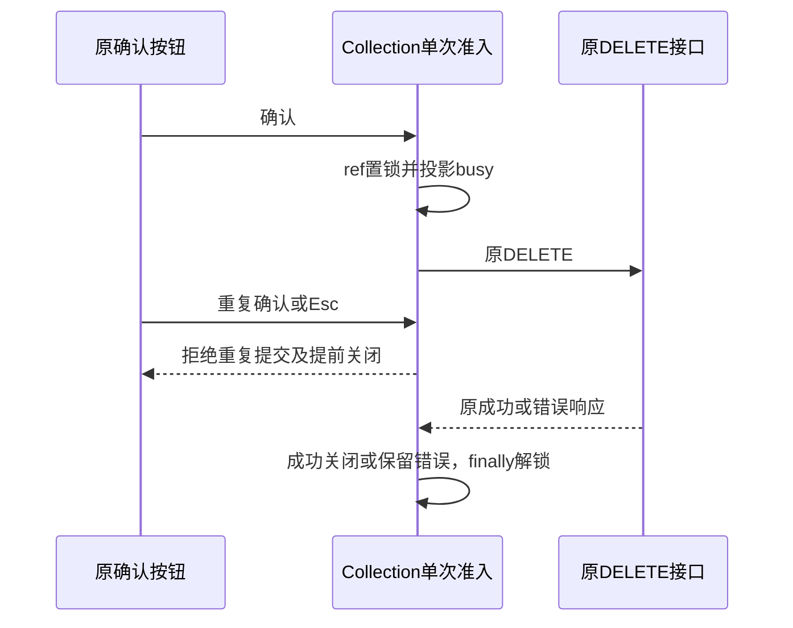

# 管理端删除确认在途保护

使用独立合成自动化记录和原管理页面，后台原DELETE实际完成业务后仅延迟第一条204的交付，不改处理器/数据库/响应正文。原确认按钮连续两次物理点击，在第一请求未返回时应只有一个DELETE，确认/取消应不可重复触发，Esc应由原Modal状态所有者阻止关闭；交付真实204后原弹框关闭，记录消失，刷新不复活。

额外错误路径：原弹框已打开时，另一个真实HTTP请求删除同一自有记录；原确认得到404后，应展示错误并解除busy，Esc/取消可以关闭。不得永久锁住弹框。测试期间运行/账本/供应商始终0；删除审计只对应真实两条记录，浏览器/控制器来源分开记。不伪造fetch响应或发浏览器业务RPC，CDP只读DOM与物理鼠标/键盘。

如果旧产品重复DELETE，保留真实RED，随后修复原确认动作在途准入及受控Modal取消默认行为，用相同链路复测。原响应gate在finally中释放，所有私有资源关闭后才通过。

状态所有者保持Collection：同步ref准入阻止同帧重复提交，busy只投影控件状态；成功后由原写路径关闭弹框，失败后原错误提示保持并在finally解除busy。原Modal阻止原生cancel默认动作，再调用原onClose，让Collection依据在途准入决定是否关闭；普通弹框仍由onClose正常关闭。

