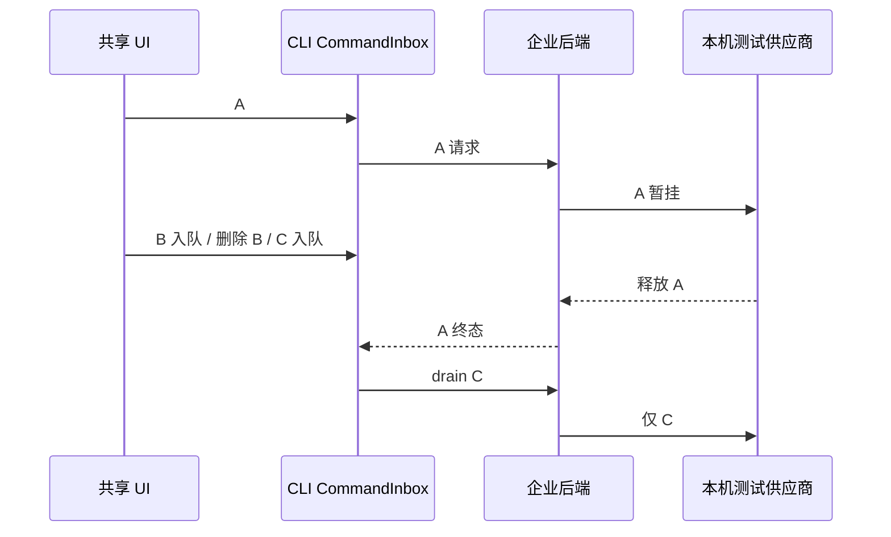

# 编译发布前真实联动补测

本轮范围取代旧平台验收优先级：使用仓库内 `clients/uwork` 的共享 UI、开发运行时与真实后端 HTTP/数据库，不测试发布安装包或各操作系统发行物。真实企微纳入；外部 MCP、网盘排除。历史报告不改写，本轮证据单独保存。

优先补齐两个实际消费者：

1. 忙任务原 Composer 发送 A，受控供应商暂挂 A；原 Composer 将 B 入队，原队列删除 B，再入队 C。供应商释放 A 后，原 CLI 队列所有者只执行 C。逐阶段核对真实请求、任务 ID、后台账本与另一成员隔离；B 不得进入供应商请求。
2. 原任务归档、归档行删除的取消和确认、刷新不复活。核对 tasks-index 的 deleted tombstone；删除不宣称擦除保留的 CLI 历史。全程不得新增推理和账本。
3. 原 assistant 回复点赞→刷新保留→点踩→刷新保留→再次点踩清除→刷新保持清除。以 CLI transcript 的 `metadata.assistantFeedback` 为持久权威，原 V4 command/event 为写入和投影路径；不得把按钮乐观态当持久化成功。请求及双方账本保持不变。

UI 只使用 browser-harness 的 CDP 输入和只读 DOM；不注入 React/store，不替换业务响应。测试模型是本机受控供应商，真实传输/调度/数据库不等于外部大模型质量验收。供应商 gate 只延迟响应，不替换队列、身份或权限所有者。每次使用独立数据根，失败保留原证据并关闭自有进程和端口。

真实企微 2026-10-21 新读验：gettoken 成功；department/list 与 agent/get 返回 60020，当前出口 IP 被拒。旧 OAuth 浏览器路径曾被自动操作策略拒绝，不换工具绕过。接口成功、目录同步、授权回调与前端登录分别验收。
