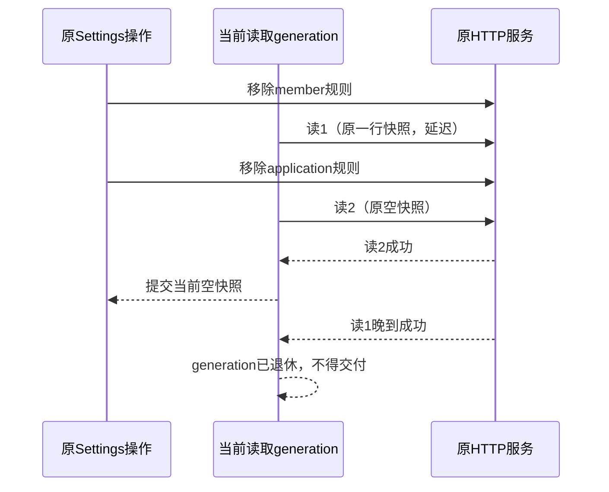

# Settings限量读取晚到覆盖保护

独立settings-race模式，以真实HTTP静态准备member和application两条限量。原页面移除member规则后，后台真实GET /limits得到仅application的一行，延迟该原响应交付；原页面再移除application规则，第二次GET /limits真实返回空并使页面为空。随后交付第一条原成功响应，页面必须仍为空，与实际DB一致，不得回灌已删除规则。

只改变自有后台一个原GET成功响应的交付时机，不改查询/正文/状态/浏览器fetch/store。以browser PerformanceResourceTiming确认晚读已在浏览器完成，再连续观察原表格；controller核DB规则0、两次原DELETE204、supplier/ledger0。真实RED后，只修复原Settings加载交付所有者的版本/退订保护和成对数据提交，不放宽断言/超时。

生产Settings保持原API和顺序，只有当前挂载/当前读取版本能提交data/retention/limits/error，旧读不得覆盖新读或已退休视图。原共享FormDialog、后端限量规则和计量合同不变。gate在finally释放，所有私有资源关闭后通过。

独占Chrome通过标准CDP关闭本target HTTP cache，让同URL两次读取能够独立并行完成；不修改应用fetch实现或响应。必须以PerformanceResourceTiming记录确认晚到原响应在浏览器完成，而不是仅凭服务端gate已释放。

真实RED v19：新读完成时表格0行；原晚读的Performance条目计数2→3、服务端原回复finish=true后，20个观察均回灌application:uwork一行，而DB仍0。修复以Settings当前挂载和读取generation为唯一交付准入；保留API读取先后顺序，但每组data/retention或data/limits全部读取成功且准入仍当前时一起提交。catch也仅允许当前读改error，卸载/换view/base退休所有在途读。

